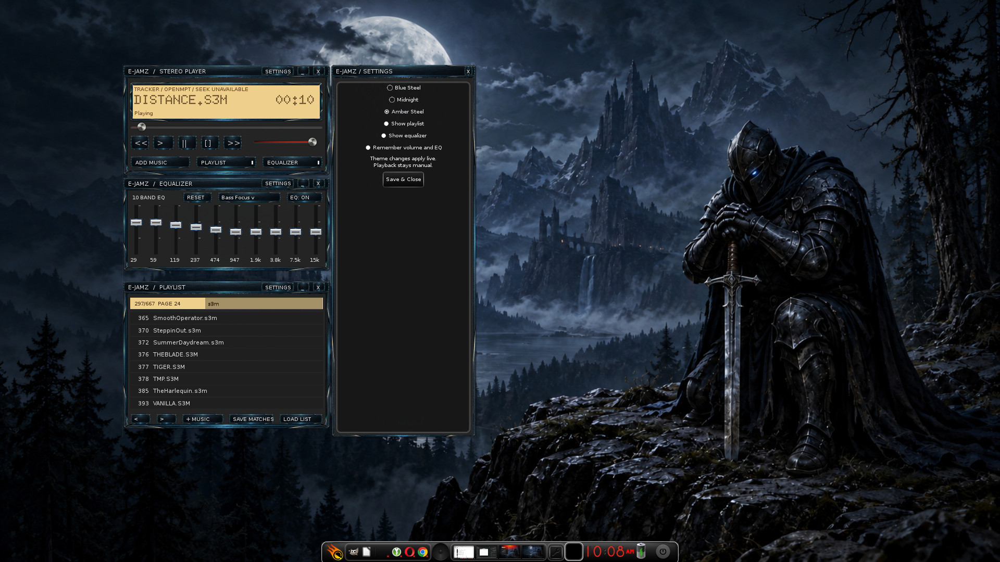

# E-Jamz

Native EFL audio player and companion EQ rack. [v0.1.0 Working beta](https://github.com/auzieman/E-Jamz/releases/tag/v0.1.0) is available; see [release scope and checks](docs/release-v0.1.0.md).



E-Jamz in Amber Steel with ten-band EQ, filtered playlist and settings drawer on the BlackKnight desktop.

See the [prototype and current limits](docs/prototype.md), including native folder/drops, wheel paging, filename/folder filtering, M3U8 save/load, EQ presets, the embedded dot-LCD display, an attached settings drawer and three live skins. Playlist loading uses a file browser filtered to M3U/M3U8; save and load remember their last folder across launches.

See the [feature list](docs/feature-map.md), [product design](docs/product-design.md),
[library relocation plan](docs/library-relocation.md) and [host audio/fixtures](docs/audio-and-fixtures.md).

See [v0 contract](docs/v0-contract.md), [interfaces](docs/interfaces.md) and [pipeline preparation](docs/pipeline.md).

Read [brief](docs/brief.md), [feature map](docs/feature-map.md), [active task](docs/task.md), [shared design/ownership contract](docs/project-contract.md), [branching](docs/branching.md) and [remote toolchain](docs/toolchain.md).

```text
src/ui/ — EFL presentation
src/core/ — application state/library/queue
src/engine/ — local media engine adapters
src/providers/ — authentication/catalog/playback adapters
assets/ — application assets
build/ — toolchain/build preparation
docs/images/ — screenshots and visual evidence
.agents/skills/ — project workflows
```

Work from development into feature/<topic>; merge accepted features back to development. Validated releases merge to main and receive annotated version tags. Source licensing and reused-asset notices must be established before distribution.

Preparation references: [visual/performance acceptance](docs/visual-performance.md) and [remote readiness](docs/preflight.md).

[Channels planning](docs/channels.md) covers the next streaming/service slice.

Source and bundled-font notices: [NOTICE.md](NOTICE.md).

Original code: **GPLv3**. Original artwork: **CC BY-SA 4.0**.
See [licensing scope and exceptions](LICENSING.md).

## AlpinE desktop and companion projects

- [AlpinEifyd](https://github.com/auzieman/AlpinEifyd): Alpine-native Enlightenment workstation and installer sources.
- [AlpinE’ifyd walkthrough](https://youtu.be/JF7gO9Wty5I): discussion and desktop tour.
- [AUZiX / AlpinE public home](https://auzix.auzietek.com/alpine/): release status and signed packages.
- [BlackKnight E Theme](https://github.com/auzieman/BlackKnight-E-Theme): companion project.

## AlpinE APK installation

Native packages are available through the signed AlpinE companion feed.
See [installation and public-key verification](https://github.com/auzieman/AlpinEifyd/blob/main/docs/companion-apks.md)
for AlpinE 3.24 x86_64. Packages preserve user settings and desktop selections.
